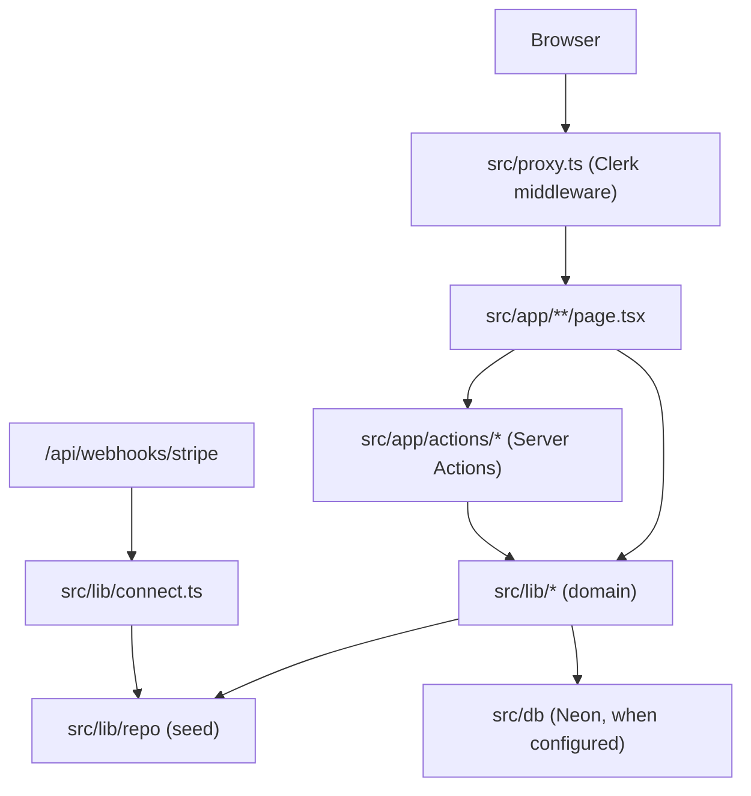
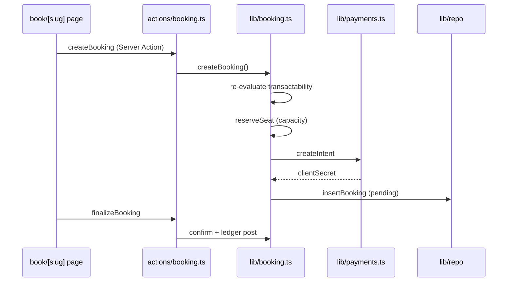

# Architecture — The Yoga Universe

System map for agents and contributors. For onboarding rules and agent behaviour, see [agents.md](../agents.md).

## Product shape

```
┌─────────────────────────────────────────────────────────────────┐
│                     The Yoga Universe                           │
├──────────────────────────────┬──────────────────────────────────┤
│   Global Index (50 cities)   │   US Transaction Layer           │
│   • Teachers, studios,       │   • Stripe Connect payouts       │
│     schools, organisers        │   • Booking + escrow             │
│   • Directory + city pages     │   • Tax (Track A / Track B)      │
│   • Blog / editorial (BLG)     │   • Ledger + commission          │
│   • SEO / i18n (7 languages)   │   • Waivers, reviews, messaging  │
├──────────────────────────────┴──────────────────────────────────┤
│   20 US cities = transactional  │  30 EU/UK/AU = index only     │
└─────────────────────────────────────────────────────────────────┘
```

**Core invariant:** transactability is derived per listing per request — never a database column (DM-7). A listing shows "Book" only when payability (US Connect active) AND tax tractability (Track A or B) both pass.

## Tech stack

| Layer | Choice | Notes |
|---|---|---|
| Framework | Next.js 16 (App Router) | SSR for all indexable pages (SEO-1) |
| Hosting | Vercel | Edge config planned for market config (ADM-5) |
| Database | Neon Postgres + Drizzle | Falls back to in-memory seed when `DATABASE_URL` unset |
| Auth | Clerk | Guest mode when keys unset (`src/lib/auth.ts`) |
| Payments | Stripe Connect / Tax / Radar | Mock provider when keys unset (`src/lib/payments.ts`) |
| Cache / rate limit | Upstash Redis | In-memory fallback in dev (`src/lib/ratelimit.ts`) |
| i18n | next-intl | 7 locales in `messages/*.json` |
| Email | Resend | Console adapter when `RESEND_API_KEY` unset |
| Tests | Vitest | Domain logic in `src/lib/*.test.ts` |

## Request flow



### Auth boundaries

`src/proxy.ts` protects `/dashboard`, `/admin`, and `/claim` when Clerk is configured. All other routes are public (index, booking, blog).

## Directory map

```
theyogauniverse/
├── agents.md                    # Agent onboarding (start here)
├── docs/
│   ├── ARCHITECTURE.md          # This file
│   ├── requirements/            # Versioned PRDs (v1.2 = active baseline)
│   ├── design/                  # Prototype + brand reference (read-only)
│   └── decisions/               # Architecture decision memos
├── lighthouserc.json            # Core Web Vitals CI budget (SEO-9)
├── tracker/                     # Requirement tracker + CI validation
│   ├── TRACKER.md               # Rollup dashboard
│   ├── BASELINE.md              # Pinned PRD checksum
│   └── sections/{FAMILY}.md     # One row per requirement ID
├── drizzle/                     # Generated migrations
├── messages/                    # i18n locale files (en, es, fr, de, it, pt, nl)
├── scripts/
│   └── extract-seed.mjs         # Regenerate seed from design prototype
└── src/
    ├── app/                     # Next.js App Router
    ├── components/              # React UI
    ├── data/                    # Seed + editorial content
    ├── db/                      # Drizzle schema + client
    ├── i18n/                    # next-intl config
    ├── lib/                     # Domain services (the brain)
    ├── proxy.ts                 # Clerk middleware (Next.js 16 proxy)
    └── test/                    # Vitest setup
```

## Routes (`src/app/`)

### Public site — `(site)/`

| Route | File | Purpose |
|---|---|---|
| `/` | `(site)/page.tsx` | Homepage |
| `/directory` | `(site)/directory/page.tsx` | Provider search/browse |
| `/[slug]` | `(site)/[slug]/page.tsx` | City landing pages |
| `/[slug]/[city]/yoga` | `(site)/[slug]/[city]/yoga/page.tsx` | City + modality pages |
| `/teachers/[slug]` | `(site)/teachers/[slug]/page.tsx` | Teacher profile |
| `/studios/[country]/[city]/[slug]` | `(site)/studios/...` | Studio profile |
| `/schools/[country]/[city]/[slug]` | `(site)/schools/...` | School profile |
| `/organisers/[slug]` | `(site)/organisers/[slug]/page.tsx` | Organiser profile |
| `/book/[slug]` | `(site)/book/[slug]/page.tsx` | Booking flow entry |
| `/booking/[reference]` | `(site)/booking/[reference]/page.tsx` | Booking confirmation |
| `/claim/[slug]` | `(site)/claim/[slug]/page.tsx` | Provider claim flow |
| `/blog/*` | `(site)/blog/**` | Editorial module (BLG) |
| `/help/*`, `/legal/*`, `/guides/*` | various | Static content pages |

### Provider dashboard — `dashboard/`

| Route | Purpose |
|---|---|
| `/dashboard` | Overview |
| `/dashboard/schedule` | Slot management |
| `/dashboard/bookings` | Booking list + check-in |
| `/dashboard/payouts` | Stripe Connect onboarding |

### Admin — `admin/`

| Route | Purpose |
|---|---|
| `/admin` | Admin console |
| `/admin/moderation` | Content moderation queue |

### API — `api/`

| Route | Purpose |
|---|---|
| `/api/v1/providers` | Public provider API |
| `/api/webhooks/stripe` | Platform payment webhooks |
| `/api/webhooks/stripe/connect` | Connected-account webhooks (PAY-4) |
| `/api/analytics` | Analytics beacon |
| `/llms.txt` | LLM-oriented site map |

## Domain layer (`src/lib/`)

Domain modules are pure, testable, and referenced by requirement ID in file headers.

### Core domain

| Module | Responsibility | Key exports |
|---|---|---|
| `transactability.ts` | DM-7 / §4.3 — derived bookability | `evaluateListing()`, `isPayable()`, `isTaxTractable()` |
| `config/markets.ts` | 50 cities, tiers, payout countries, Track B flags | `CITIES`, `PAYOUT_ELIGIBLE_COUNTRIES` |
| `types.ts` | Shared domain types | `Provider`, `Listing`, `Booking`, `Transactability` |
| `money.ts` | DM-4 — integer minor units | `money()`, `Money` |
| `taxonomy.ts` | Modalities, lineages, tags | Taxonomy constants and helpers |

### Transaction layer

| Module | Responsibility |
|---|---|
| `booking.ts` | BKG — state machine, capacity, idempotency, server-side transactability recheck |
| `payments.ts` | PAY-1 — payment orchestration interface (Stripe + mock) |
| `connect.ts` | PAY-2/PAY-4 — Connect account lifecycle |
| `commission.ts` | PAY-5 — platform fee resolution |
| `tax.ts` | PAY-10/11 — Track A (in-person) and Track B (online) tax |
| `ledger.ts` | PAY-14 — double-entry ledger postings |
| `scheduling.ts` | SCH — RRULE-based occurrence generation |
| `schedule-import.ts` | SCH — bulk schedule import |
| `waivers.ts` | WVR — waiver capture before attendance |
| `offers.ts` | Promotional offers / pricing rules |

### Index layer

| Module | Responsibility |
|---|---|
| `search.ts` | SRCH — query parsing and filtering |
| `ranking.ts` | SRCH — result ranking signals |
| `listing-view.ts` | LST — listing presentation model |
| `buyer.ts` | Buyer context resolution (country for Track B) |
| `seo.ts` | SEO — metadata, canonical URLs |
| `urls.ts` | URL builders for provider/city routes |

### Provider ops

| Module | Responsibility |
|---|---|
| `dashboard.ts` | DASH — provider dashboard data |
| `reviews.ts` | REV — review submission and display |
| `messaging.ts` | MSG — provider-buyer messaging |
| `ingestion.ts` | ING — data ingestion pipeline |
| `moderation.ts` | ADM — moderation queue |
| `email.ts` | Transactional email (Resend / console) |
| `analytics.ts` | ANL — event tracking |
| `ratelimit.ts` | NFR — Upstash / in-memory rate limiting |
| `auth.ts` | ACC — Clerk enablement check |

### Editorial (BLG module)

| Module | Responsibility |
|---|---|
| `editorial/gate.ts` | Content quality gate (corpus-tested) |
| `editorial/store.ts` | Article index and lookups |
| `editorial/linking.ts` | Internal link graph |
| `editorial/attribution.ts` | Author attribution rules |
| `editorial/disclaimers.ts` | Health/wellness disclaimers |
| `data/editorial/` | Static editorial content (posts, pillars, clusters, authors) |

## Data layer

### Two-mode data access

```
Development (no DATABASE_URL)          Production (DATABASE_URL set)
─────────────────────────────          ─────────────────────────────
src/lib/repo/index.ts                  src/db/index.ts + Drizzle
  └─ src/data/seed.ts                    └─ src/db/schema.ts
       └─ prototype.json                      └─ drizzle/ migrations
```

`src/lib/repo/index.ts` is the current read/write path. It wraps the in-memory seed store with mutable demo state (bookings, capacity deltas, Connect overrides) on `globalThis` for HMR survival. Production migration to Drizzle queries behind the same function signatures is the intended end state — check repo module comments before assuming DB-backed reads.

### Schema highlights (`src/db/schema.ts`)

| Rule | Enforcement |
|---|---|
| DM-1 | `teaches_at` is many-to-many, time-bounded |
| DM-2 | Listings and occurrences are separate entities |
| DM-3 | `provenance`, `confidence_score`, `last_verified_at` on entities |
| DM-4 | Money as integer minor units + ISO-4217 currency |
| DM-5 | UTC timestamps; occurrences carry IANA timezone |
| DM-6 | Soft-delete via `deleted_at` |
| DM-7 | **No transactability column** — derived in application layer |
| DM-8 | `supply_type` + `performance_country` required on publish |

## Transactability engine

The most important domain rule. Read `src/lib/transactability.ts` before touching booking, listing, or payment code.

```
Transactability = Payable AND TaxTractable

Payable:
  organisation.domicile ∈ PAYOUT_ELIGIBLE_COUNTRIES (US only in v1)
  AND connectStatus === "active"

TaxTractable:
  Track A (in_person): performanceCountry === "US"
  Track B (online_live | on_demand): trackBEnabledForBuyer(buyer.country)
```

Track B results are **request-scoped** — they depend on the viewing buyer's country and must be evaluated at render time and again server-side at booking time.

## Booking flow



State machine transitions are defined in `booking.ts` (`TRANSITIONS` map). Invalid transitions are rejected.

## Payments architecture

```
booking.ts  ──►  payments.ts (interface)
                      ├── StripeProvider (STRIPE_SECRET_KEY set)
                      └── MockProvider   (dev/CI default)

connect.ts  ◄──  /api/webhooks/stripe/connect (account.updated)
payments.ts ◄──  /api/webhooks/stripe (payment_intent.*)
```

Card data never touches this server (PAY-15 / SAQ-A). The browser confirms via Stripe Payment Element.

## SEO & AEO

**Every indexable page must be optimized for both traditional search engines and AI answer engines.** This is a first-class requirement, not an afterthought. Tracker: `tracker/sections/SEO.md` (16 requirements). Blog editorial has additional BLG SEO rules.

### Philosophy

| Channel | Goal | How |
|---|---|---|
| **SEO** (Google, Bing) | Rank for intent-matched queries | SSR, metadata, schema.org, sitemaps, CWV, internal links |
| **AEO** (ChatGPT, Perplexity, AI Overviews) | Be cited accurately by assistants | Direct-answer blocks, question-shaped headings, visible FAQs, `/llms.txt`, AI crawler access |

AI crawlers largely do not execute JavaScript (SEO-1). Client-rendered indexable content is invisible to both search and answer engines.

### Infrastructure map

| File | Requirement | Purpose |
|---|---|---|
| `src/lib/seo.ts` | SEO-4, SEO-4a | `cityPageIndexable()` thin-page gate, `siteUrl()` |
| `src/app/sitemap.ts` | SEO-8 | Segmented sitemap; omits `noindex` pages |
| `src/app/robots.ts` | SEO-5, SEO-11 | Allows AI crawlers; disallows private surfaces |
| `src/app/llms.txt/route.ts` | SEO-13 | Curated AI-ingestion site map |
| `src/components/JsonLd.tsx` | SEO-2, SEO-3 | Renders `application/ld+json` blocks |
| `next.config.ts` | SEO-1, SEO-9 | SSR enforced; security headers; Lighthouse CI budget |
| `lighthouserc.json` | SEO-9 | LCP 2.5 s / CLS 0.1 / TBT 300 ms CI gate |

### Page-type checklist

Every new or changed **indexable** route must satisfy the rows relevant to its type:

| Page type | Metadata | AEO content | JSON-LD | Index rule |
|---|---|---|---|---|
| City hub (`/[country]/[city]/yoga`) | title, description, canonical | 40–60 word answer, FAQ, question H2s | `ItemList`, `BreadcrumbList`, `FAQPage` | `cityPageIndexable()` — auto `noindex` below threshold |
| Provider profile | title (name), description (tagline ≤160), canonical | Tagline as direct answer, style tags, schedule | `Person`/`LocalBusiness`/`Organization`; `Offer` only if bookable | Always indexable |
| Directory | title, description, canonical | Intro paragraph, filter context | `ItemList` where applicable | Always indexable |
| Blog article | title, description, canonical, OG article | Answer block first (BLG-35), trust block, FAQ, references | `Article` with author/reviewer/dates | `noindex` when review-decayed (BLG-24) |
| Help / guides | title, description, canonical | Direct answer, step-by-step structure | `FAQPage` or `Article` as appropriate | Always indexable |
| Link-in-bio (`/[slug]`) | title, description | Short tagline | None required | **`noindex`** — canonical is full profile (PRO-7) |
| Dashboard / admin / booking | `noindex` or excluded | N/A | None | Disallowed in `robots.ts` |

### AEO content template

Hub and content pages follow this order (blog articles are contractual — see `blog/[slug]/page.tsx` header comment):

```
H1 (question or intent-matched)
  ↓
Direct answer (40–60 words, first content on page)
  ↓
Trust signals (verification, credentials, dates)
  ↓
Question-shaped H2 sections
  ↓
Tables / lists / comparison blocks
  ↓
Visible FAQ (with fragment ids: #faq-question-slug)
  ↓
Internal links (city ↔ style ↔ provider ↔ blog)
```

Reference implementations:
- City hub: `src/app/(site)/[slug]/[city]/yoga/page.tsx`
- Blog article: `src/app/(site)/blog/[slug]/page.tsx`
- Provider profile: `src/components/site/ProviderProfile.tsx`

### Structured data rules (SEO-15)

```
Bookable listing  →  emit Offer (price, currency, InStock)
Enquiry-only      →  omit Offer entirely (do NOT imply purchasable)
Has reviews       →  AggregateRating only if REV-8 minimum sample met
City page         →  ItemList of providers + BreadcrumbList
Blog post         →  Article with author, datePublished, dateModified
```

The `jsonLdFor()` function in `ProviderProfile.tsx` is the canonical pattern for Offer honesty.

### Thin-page suppression (SEO-4)

```typescript
// src/lib/seo.ts
cityPageIndexable(providers) =>
  providers.length >= 3
  || (providers.length >= 1 && hasVerifiedProvider)
```

- Enforced at **render time** in `generateMetadata()` — not a batch job
- **Non-overridable** by Ops
- Measures **content quality**, not transactability (SEO-4a)
- Sitemap (`sitemap.ts`) and `llms.txt` both respect the same gate

### AI crawler policy (SEO-11)

`robots.ts` allows all crawlers including `GPTBot`, `ClaudeBot`, `PerplexityBot`, `Google-Extended`. Being quoted by AI assistants is distribution, not a threat.

Only genuinely private surfaces are disallowed: `/dashboard`, `/admin`, `/book/`, `/claim/`, `/api/`.

### `/llms.txt` maintenance

When adding a new top-level content type (e.g. a new guide section, modality hub, or place page), update `src/app/llms.txt/route.ts` to include it in the curated map. This is the primary discovery path for AI ingestion.

### SEO requirements still in progress

Check `tracker/sections/SEO.md` before assuming complete coverage:

| ID | Status | Gap |
|---|---|---|
| SEO-2 | in-progress | City-style and neighbourhood pages pending |
| SEO-3 | in-progress | Event/Course schema pending |
| SEO-5 | todo | Explicit AI bot entries in robots.txt |
| SEO-7 | in-progress | hreflang across 7 locales |
| SEO-9 | in-progress | Lighthouse CI needs runs on real deploys |
| SEO-10 | todo | Redirect discipline (301/410) |
| SEO-11 | todo | Internal linking engine (taxonomy-driven) |
| SEO-12 | todo | Programmatic meta from CMS templates |
| SEO-14 | todo | AI-citation monitoring KPI |

## Components (`src/components/`)

| Directory | Contents |
|---|---|
| `site/` | Public UI — `Header`, `Footer`, `ProviderCard`, `BookingFlow`, `ProviderProfile`, editorial components |
| `dashboard/` | Provider UI — `CheckInForm` |
| `ui.tsx` | Shared primitives (buttons, inputs, badges) |
| `JsonLd.tsx` | Structured data injection |

Design tokens and typography are in `src/app/globals.css` (Petrona display, Roboto body).

## Server Actions (`src/app/actions/`)

| File | Actions |
|---|---|
| `booking.ts` | `createBooking`, `createPaymentSession`, `finalizeBooking`, `abandonPaymentSession` |
| `dashboard.ts` | `addSlotAction`, `removeSlotAction`, `setCapacityAction`, `checkInAction` |
| `payouts.ts` | Connect onboarding, status sync, Express dashboard, payout schedule |
| `contact.ts` | `sendContactMessage` (outbound contact — PAY-17a constraints) |

## Requirements tracker

Build progress is tracked at the requirement-ID level, not the file level.

```
tracker/
├── BASELINE.md          # SHA-256 of active PRD
├── TRACKER.md           # Generated rollup + unmapped implementation changes
└── sections/
    ├── DM.md            # Domain model (8 reqs)
    ├── BKG.md           # Booking (21 reqs)
    ├── PAY.md           # Payments (22 reqs)
    ├── BLG.md           # Blog module (69 reqs)
    └── …                # 25 section families total
```

The tracker is part of the implementation, not optional project management.
Every material implementation, behavior change, fix, refactor, integration,
security update, or SEO/AEO update must update all affected requirement rows in
the same change. Notes state what exists, verification performed, and remaining
gaps. If no requirement ID applies, record the work under **Unmapped
implementation changes** in `tracker/TRACKER.md` rather than inventing an ID.
Regenerate the rollup when statuses change and run `pnpm tracker:validate`.

## Deployment, infrastructure & secrets

The production architecture is Vercel-managed and agent-operated:

```text
Cursor agent
  ├─ Vercel MCP / CLI
  │    ├─ Next.js hosting + backend functions
  │    ├─ encrypted, environment-scoped secrets
  │    └─ preview and production deployments
  ├─ Vercel Marketplace → Neon Postgres
  │    ├─ Drizzle ORM + migrations
  │    └─ isolated branches for preview/dev
  └─ Vercel Marketplace → Upstash Redis
       ├─ rate limiting
       └─ cache with bounded TTLs
```

### Platform ownership

| Concern | Platform | Rule |
|---|---|---|
| Frontend and backend | Vercel | Next.js pages, Server Actions, route handlers, webhooks, and deployments |
| Relational data | Neon Postgres via Vercel Marketplace | Server-only `DATABASE_URL`; Drizzle queries and migrations |
| Cache / abuse controls | Upstash Redis via Vercel Marketplace | Server-only REST token; TTLs and namespaced keys |
| Secrets | Vercel environment variables | Encrypted and scoped independently to development, preview, and production |
| Local environment | `.env.local` / `.env.*.local` | Gitignored; populated by agent tooling without printing values |

Do not use the sunset `@vercel/postgres` or `@vercel/kv` packages. This project uses `@neondatabase/serverless` and `@upstash/redis`.

### Secret boundaries

```text
Public / browser-safe:
  NEXT_PUBLIC_SITE_URL
  NEXT_PUBLIC_CLERK_PUBLISHABLE_KEY
  NEXT_PUBLIC_STRIPE_PUBLISHABLE_KEY

Server-only secrets:
  DATABASE_URL
  CLERK_SECRET_KEY
  STRIPE_SECRET_KEY
  STRIPE_WEBHOOK_SECRET
  STRIPE_CONNECT_WEBHOOK_SECRET
  UPSTASH_REDIS_REST_TOKEN
  RESEND_API_KEY
```

`NEXT_PUBLIC_` means embedded in the browser bundle. Never place a secret under that prefix. URLs can also be sensitive when they contain credentials; `DATABASE_URL` and authenticated Upstash URLs must never be logged or returned to clients.

### Required security controls

- Authenticate and authorize every protected Server Action and API route; ownership and roles are resolved server-side
- Recompute price, capacity, tax, commission, and transactability on the server—never trust browser values
- Validate all untrusted input and use parameterized database access
- Verify webhook signatures against raw bodies and preserve idempotency
- Apply Upstash rate limits to public, authentication, contact, booking, and sensitive mutation endpoints
- Redact credentials, tokens, personal data, payment data, and provider payloads from logs and errors
- Keep development, preview, and production credentials and data isolated
- Use Neon branches and Vercel preview deployments for testing migrations and integrations
- Never perform destructive production migrations or data deletion without explicit narrow approval and a recovery plan
- Treat `.env.example` as names-only documentation; values remain empty

### Agent automation contract

Agents are expected to perform routine infrastructure work, not delegate it back to the user:

1. Use Vercel/provider MCP tools when available; otherwise install and use the appropriate CLI non-interactively.
2. Link the repository to the correct Vercel project.
3. Provision Neon and Upstash through the Vercel Marketplace when needed.
4. Configure environment-scoped variables without exposing their values.
5. Create isolated preview/database branches, run migrations, deploy, and verify end-to-end.
6. Report the completed outcome and any security blindspots.

Manual user action should be requested only for unavoidable authentication or authorization, billing/domain purchase, CAPTCHA/passkey approval, destructive production actions, or product decisions. An implementation request alone does not authorize production deployment, paid purchases, or destructive data changes.

## Environment variables

See [.env.example](../.env.example). Summary of fallbacks:

| Variable | Unset behaviour |
|---|---|
| `DATABASE_URL` | In-memory seed repo |
| Clerk keys | Guest auth, no sign-in |
| Stripe keys | Mock payment provider |
| Upstash keys | In-memory rate limiter |
| `RESEND_API_KEY` | Console email adapter |

## Testing

```bash
pnpm test                    # all unit tests
pnpm test src/lib/booking    # single module
pnpm editorial:gate          # BLG content quality corpus
pnpm tracker:validate        # tracker ↔ PRD integrity
```

Tests live alongside domain modules (`*.test.ts`). The booking, payments, transactability, scheduling, ledger, and ranking engines all have coverage.

## Key documents

| Document | When to read |
|---|---|
| `docs/requirements/yoga-platform-requirements-v1.2.md` | Any product behaviour question |
| `docs/requirements/yoga-platform-blog-module-requirements-v1.0.md` | Editorial / blog work |
| `docs/decisions/decision-17-stripe-managed-payments.md` | Why Connect (not MoR) |
| `docs/design/FRONTEND.md` | Visual / UX reference |
| `tracker/TRACKER.md` | What's built vs. what's left |
| `tracker/sections/SEO.md` | SEO/AEO requirement status (16 IDs) |

## Build phases (historical context)

| Phase | Scope | Status |
|---|---|---|
| 0 | Repo, tracker, CI, design system | Complete |
| 1 | Domain model, auth, taxonomy, transactability, seed | Complete |
| 2 | Global index: profiles, listings, city pages, search, SEO, claim | Complete (per-row gaps in tracker) |
| 3 | US transactions: booking, Stripe, tax, ledger, waivers | Complete (mock rail; live Stripe pending) |
| 4 | Dashboards, admin, ingestion, integrations, compliance | Complete (per-row gaps in tracker) |

Remaining work is tracked per requirement ID, not per phase.

## Open blockers (non-engineering)

| Decision | Impact |
|---|---|
| ~~#7 — Legal sign-off on non-US ingestion~~ | **Resolved 29 Jul 2026** ([memo](decisions/decision-7-non-us-ingestion.md)) — publication approved; ING-7 removal flow shipped (`/legal/removal`, 72h SLA, permanent tombstone) |
| ~~#9 — Brand / trademark clearance~~ | **Resolved 29 Jul 2026** ([memo](decisions/decision-9-trademark.md)) — launch proceeds under the brand |
| ~~NFR-5 — WCAG independent audit~~ | **Removed 29 Jul 2026** ([memo](decisions/decision-nfr5-wcag-audit.md)) — no accessibility filters marketed or shipped |
| BLG open decisions | See `tracker/TRACKER.md` blog section |
